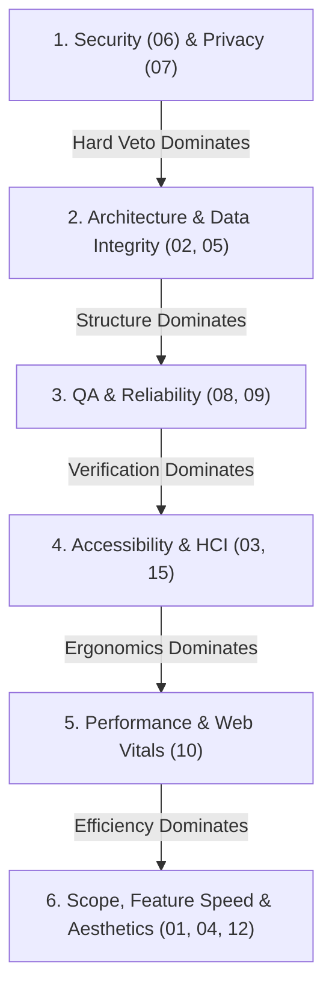

# Cross-Specialist Conflict & Deadlock Resolution Matrix

> **Governance Authority:** Lead System Architect (`02-architecture`) & Team Orchestrator (`00-orchestrator`)  
> **Rule Order:** Security & Privacy > Architecture > Performance > Speed  
> **Status:** Active & Deterministically Enforced

When multiple specialist personas hold competing priorities or conflicting vetos, this matrix governs the non-negotiable arbitration path. Agents and engineers must not silently resolve trade-offs or downgrade gates.

---

## 1. The Core Hierarchy

---

## 2. Deadlock Resolution Scenarios

| Conflict Scenario | Competing Specialists | Governing Principle | Binding Resolution (Non-Negotiable) | Escalation / ADR Requirement |
|---|---|---|---|---|
| **A. Security Hard Veto vs. MVP Speed** | `06-security` vs `01-product-discovery` | Hard Veto Dominance | **Cut feature scope, never lower cryptographic standards.** Plain-text passwords, client-side pricing, or raw SQL queries are blocked unconditionally even for MVPs. | Record scope cut in `PROGRESS.md`. |
| **B. Performance Optimization vs. Accessibility** | `10-performance` vs `03-ux-ui-design` / `15-hci-interaction` | Ergonomics over Sub-millisecond speed | **WCAG 2.2 AA and Fitts's Law touch targets (min 44x44px) take precedence over micro-optimizations.** You cannot strip ARIA labels, semantic `<main>` tags, or keyboard focus outlines to save DOM bytes. | Mandatory Section 14 pre-flight check in `DESIGN.md`. |
| **C. Premature Microservices vs. Simple Monolith** | `09-devops-infra` vs `02-architecture` | Ponytail Decision Ladder & YAGNI | **Reject microservices below SCALE tier.** A modular monolith with clean domain boundaries must be deployed unless >100k MAU or autonomous multi-team requirements exist. | Author ADR in `DECISIONS.md` before provisioning distributed queues. |
| **D. Pre-Consent Analytics vs. Growth Tracking** | `07-privacy-compliance` vs `11-seo-marketing` | Privacy Hard Veto | **No pre-consent cookies or personal data capture.** Privacy-preserving cookieless telemetry (anonymized IP hash, zero storage) or opt-in consent banner is required. | Mandatory GDPR/ePrivacy compliance sign-off. |
| **E. Destructive DB Migration vs. Feature Velocity** | `05-backend-data` vs `01-product-discovery` | Data Integrity & Zero Downtime | **Destructive table alterations on live tables are forbidden.** Must use the 3-phase Expand-Contract pattern (Add nullable column $\rightarrow$ Dual-write $\rightarrow$ Migrate $\rightarrow$ Contract). | Migration runbook in `templates/schemas/runbook.schema.json`. |
| **F. "Works on my machine" vs. QA Evidence** | Implementer vs `08-testing-qa` | No Evidence, No Ship | **Self-asserted claims are rejected.** If automated tests, linter output, and terminal exit codes are not shown, release gate is BLOCKED. | Recorded test log in PR / handoff. |
| **G. Visual Flare vs. Cognitive Load** | `04-frontend` vs `15-hci-interaction` | Anti-Slop & Cognitive Restraint | **Excessive parallax, 3D canvases, or continuous canvas loops that breach Doherty threshold or distract from primary task are stripped.** GSAP motion must obey `prefers-reduced-motion`. | Design contract in `DESIGN.md`. |

---

## 3. Formal Escalation Procedure

When a trade-off is not covered by the scenarios above:

1. **State the Conflict Explicitly:** Output `[CONFLICT DETECTED: <Specialist A> vs <Specialist B>]`.
2. **Apply Ponytail Decision Ladder:**
   - 1) YAGNI (Can we delete the conflicting feature?)
   - 2) Codebase reuse
   - 3) Web Platform Native standard
   - 4) Installed dependency
   - 5) Minimal viable implementation
3. **Draft an ADR:** If an exception is requested, record an `ACCEPTED-RISK` entry in `DECISIONS.md` with user approval.
